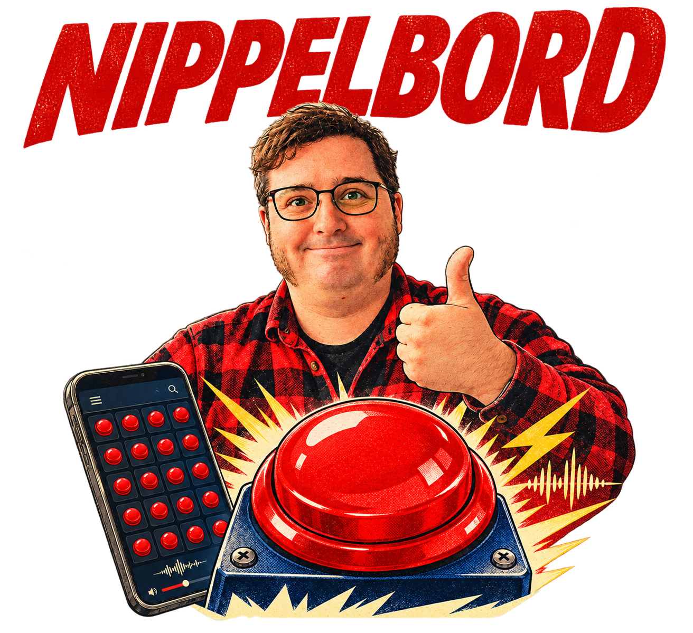

<div align="center">

<h1>🔴 Nippelboard</h1>

<p><strong>Drück drauf. Der Spruch sitzt.</strong><br>
Ein Soundboard von Manuel Pollhammer für Web und Android.</p>

<p><a href="https://www.pollhammer.org/nippel"><strong>▶ Soundboard öffnen</strong></a> · <a href="./Nippelboard%20v1.6.apk?raw=true"><strong>↓ Android-APK v1.6</strong></a></p>



</div>

## 112 Sounds. Sechs Kategorien.

**TV Total · Fun · Media Markt · Werner · SFX · Andreas**

Für eine klare Ansage, ein gut getimtes „Ja, Tschüss“ oder einfach, weil der rote Knopf so schön glänzt.

| Im Browser | Auf Android |
| --- | --- |
| Soundboard direkt öffnen oder die `index.html` lokal starten | Signierte APK installieren und offline nutzen |
| Sounds suchen, als Favoriten merken und die Lautstärke regeln | Mit gespeicherten Favoriten direkt in der Favoritenansicht starten |
| Sounds über das Drei-Punkte-Menü teilen oder speichern | Eigene MP3- und WAV-Dateien hinzufügen und wieder entfernen |

## Was ist neu in v1.6?

Die mitgelieferte Sammlung umfasst jetzt dieselben **112 Sounds in sechs Kategorien** wie die Webversion. Suche, Favoriten und der Import eigener Sounds stehen in der Android-App weiterhin zur Verfügung.

## Android-App selbst bauen

1. Den Ordner [`android/`](./android/) in Android Studio öffnen.
2. JDK 17, Android SDK Platform 35 und Build-Tools 35.0.1 verwenden.
3. Mit Gradle 8.11.1 im Ordner `android/` einen Debug-Build starten.

```bash
gradle assembleDebug
```

Die Test-APK liegt danach unter `android/app/build/outputs/apk/debug/app-debug.apk`. Sie verwendet eine Debug-Signatur. Wer die bereitgestellte App aktualisieren möchte, verwendet die signierte APK.

---

**by Manuel Pollhammer** · [pollhammer.org/nippel](https://www.pollhammer.org/nippel)
